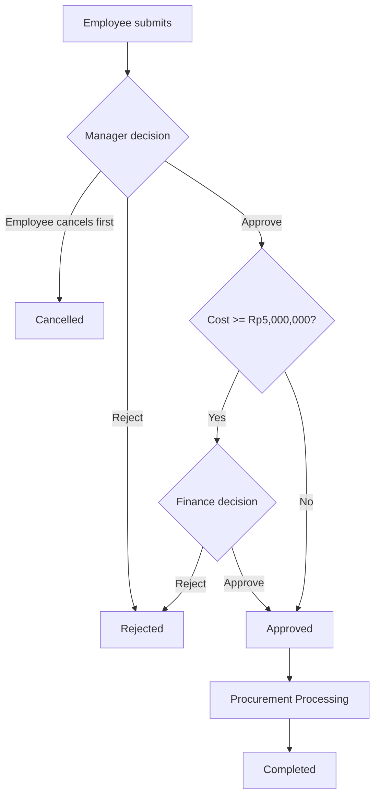
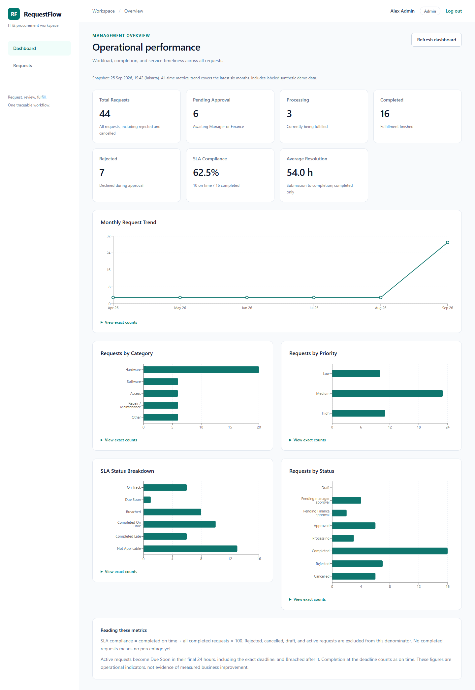
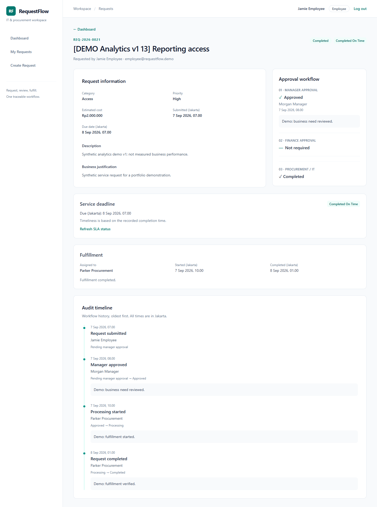
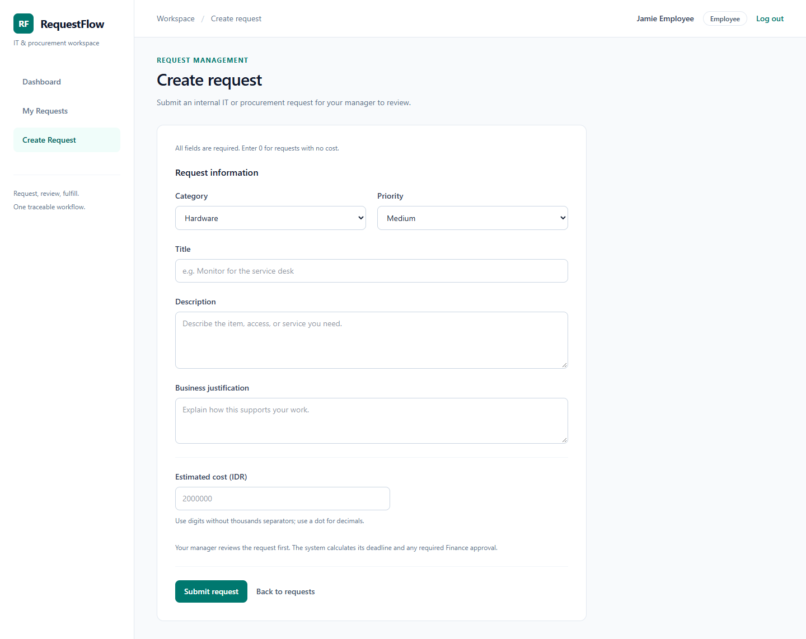
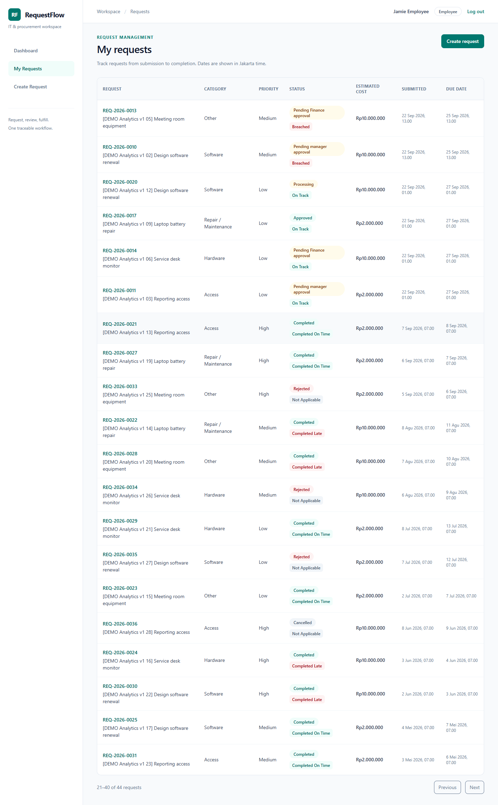
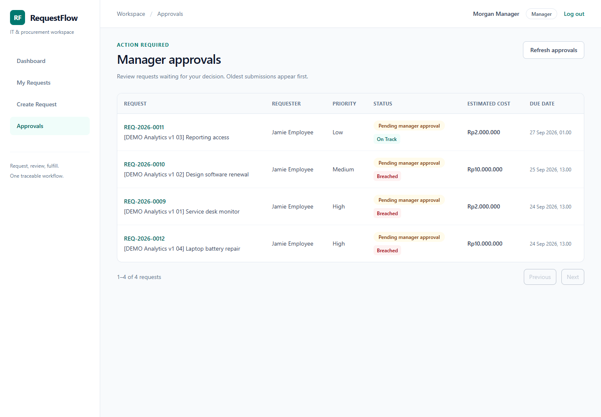
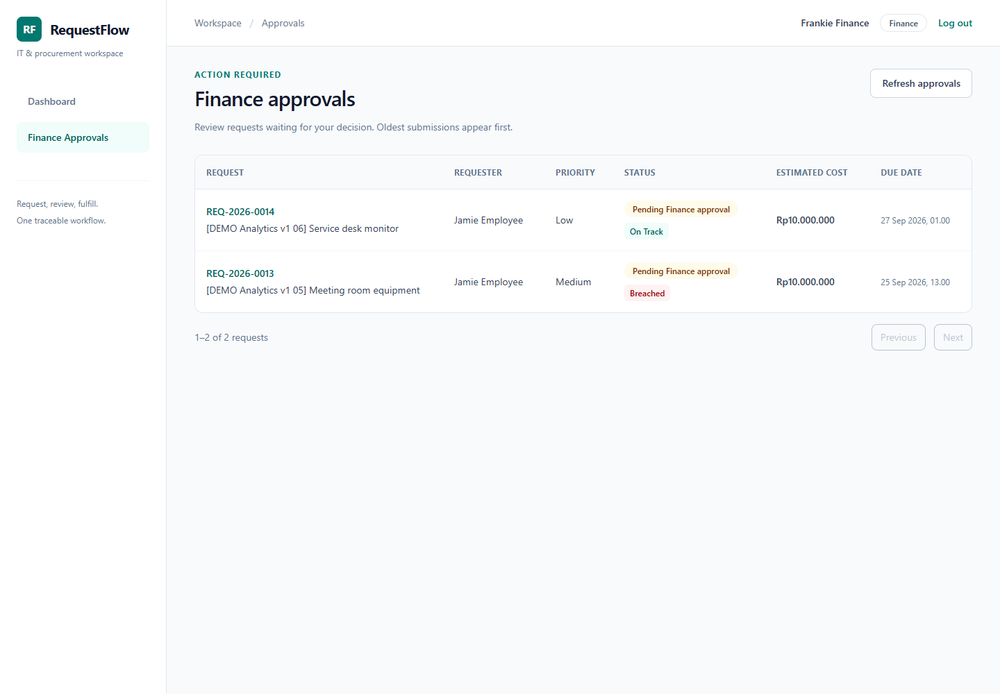
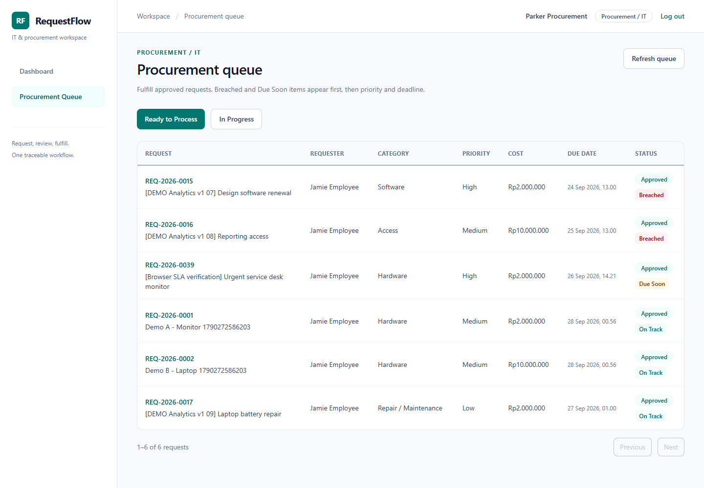
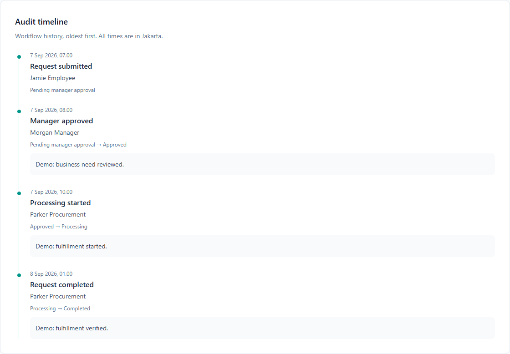
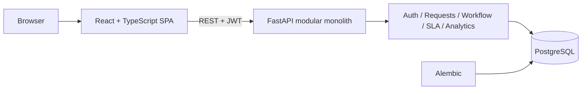

# RequestFlow

RequestFlow is a portfolio case study and full-stack internal IT and procurement
request automation system. It replaces a simulated process spread across chat, email,
and spreadsheets with one role-based, auditable workflow from submission to fulfillment.

> **Public-demo notice:** RequestFlow uses synthetic accounts and data. It is not
> intended for real company requests, personal information, credentials, or other
> sensitive content.

## Live demo

- **Application:** [https://requestflow-one.vercel.app](https://requestflow-one.vercel.app)
- **API:** [https://requestflow-api-production.up.railway.app](https://requestflow-api-production.up.railway.app)
- **Interactive API docs:** [https://requestflow-api-production.up.railway.app/docs](https://requestflow-api-production.up.railway.app/docs)
- **Source:** [current GitHub repository](.)

## Overview

The project connects business analysis artifacts to a working application. It includes
an assumed AS-IS process, implemented TO-BE process, stakeholders, requirements, user
stories, business rules, architecture, database design, API, automated verification,
and deployment configuration. It targets IT Intern, IT Consultant Intern, and Business
Analyst Intern portfolios without claiming results from a real-company rollout.

## Business problem

In the simulated scenario, requests arrive through several channels. Information can
be fragmented, current status and ownership are unclear, cost-based routing is
inconsistent, decision history is difficult to audit, and management reporting
requires manual reconciliation.

RequestFlow proposes one request record, consistent routing, visible ownership and
deadlines, chronological audit history, and defined management measures. See the
[business problem](docs/business-problem.md) for assumptions and evidence boundaries.

## Solution and key features

- JWT authentication with five seeded demo roles and Argon2id password hashing
- Employee-to-Manager relationship and object-level request visibility
- Validated request submission with exact decimal Rupiah costs
- Manager approval/rejection and conditional Finance routing
- Requester cancellation before Manager decision
- Procurement queue, explicit ownership, Processing, and completion
- Human/system audit timeline committed with workflow changes
- Read-time SLA state and urgency ordering
- Admin-only KPI cards and five responsive charts
- Loading, empty, recovery, confirmation, mobile navigation, and keyboard focus states
- PostgreSQL migrations, constraints, row locking, and concurrency tests

## Business workflow



Invalid transitions are blocked by backend role, object, state, assignment, and
ownership checks. See the [TO-BE process](docs/to-be-process.md) and
[state machine](docs/request-state-machine.md).

## Core business rules

- Cost **below Rp5,000,000** skips Finance; cost **at or above Rp5,000,000** requires it.
- Rejection requires a reason.
- The requester may cancel only while awaiting Manager approval.
- Only Approved requests can enter Processing.
- The Procurement user who starts a request becomes its owner; only that owner completes it.
- High, Medium, and Low priorities are due in 1, 3, and 5 calendar days.
- Due Soon covers exactly 24 hours remaining through the deadline; afterward is Breached.
- Completion at the exact deadline is on time. Rejected/Cancelled are Not Applicable.

The complete normative list is in [business-rules.md](docs/business-rules.md).

## User roles

| Role | Main responsibility | Access boundary |
| --- | --- | --- |
| Employee | Submit and track needs | Own requests; cancel only before Manager decision |
| Manager | Review direct-report requests | Assigned Manager decisions only |
| Finance | Review threshold-routed costs | Pending Finance decisions and routed history |
| Procurement | Fulfill approved work | Start Approved; complete only owned Processing |
| Admin | Review global operations | All data and analytics; no workflow override |

## Screenshots

All screenshots use synthetic demo data.

| Admin dashboard | Request detail |
| --- | --- |
|  |  |
| Create request | My Requests |
|  |  |
| Manager approvals | Finance approvals |
|  |  |
| Procurement queue | Audit timeline |
|  |  |

## System architecture



Vercel serves the frontend. Railway runs the FastAPI container and a private
PostgreSQL service. The backend remains one modular application, not microservices. Read the
[architecture](docs/system-architecture.md) and [deployment guide](docs/deployment.md).

## Technology stack

| Layer | Technology |
| --- | --- |
| Frontend | React 19, TypeScript, Vite, Tailwind CSS, React Router, Recharts |
| Backend | Python 3.12, FastAPI, Pydantic, SQLAlchemy |
| Data | PostgreSQL 17, Alembic |
| Identity | JWT (HS256), Argon2id |
| Local operations | Docker Compose |
| Verification | Pytest, real PostgreSQL schemas, Playwright / Edge |
| Deployment target | Vercel frontend; Railway API and PostgreSQL |

## Database and backend design

Users have a self-referencing `manager_id`. Requests belong to a requester and may
gain a Procurement owner. Each request has at most one Manager and one Finance
approval. Audit events belong to a request and optionally a human actor. A PostgreSQL
sequence issues unique display numbers; gaps after rollback are expected.

FastAPI validates request bodies, authenticates each protected call, reloads the
active user/role from PostgreSQL, and delegates to centralized services. Mutations
lock the request and atomically update state, approval/ownership fields, timestamps,
and audit events. Alembic revisions 0001–0003 create the schema; startup does not use
`create_all`. See the [database design](docs/database-design.md) and
[API map](docs/api-documentation.md). Interactive OpenAPI documentation is available
at `/docs` when the backend runs.

## SLA monitoring

SLA state is derived at read time rather than stored. Active requests are On Track,
Due Soon, or Breached. Completed requests are Completed On Time or Completed Late.
Rejected, Cancelled, and reserved Draft requests are Not Applicable. The Procurement
queue sorts breached and due-soon work first. Details and boundary behavior are in
[sla-monitoring.md](docs/sla-monitoring.md).

## Dashboard and analytics

Admin sees total requests, pending approvals, Processing, Completed, Rejected, SLA
compliance, average resolution hours, and category/priority/status/SLA/month charts.

**SLA Compliance = Completed On Time ÷ All Completed SLA-applicable Requests × 100.**

With no completed requests, compliance and average resolution display an em dash.
Average resolution is `completed_at - created_at`. The system reports application
data and synthetic fixtures; it makes no benchmark or improvement claim. See
[dashboard-analytics.md](docs/dashboard-analytics.md).

## Security and authorization

Implemented controls include Argon2id hashes, validated JWT claims, backend RBAC,
object-level filtering, workflow validation, row locks, environment-configured secrets,
explicit CORS origins, transaction rollback, audit mutation protections, safe API
errors, and no-store/nosniff/referrer headers.

This is not enterprise-secure software. JWTs remain in localStorage, copied tokens
cannot be revoked server-side, login is not throttled, no independent audit was
performed, and a database owner can alter data. See [security.md](docs/security.md).

## Testing

Latest local quality gate:

- **116 backend tests passed** against PostgreSQL
- frontend TypeScript production build passed
- frontend lint passed
- five browser regression groups passed; responsive rerun passed
- Alembic reported no schema drift; schema remains revision 0003

Coverage includes authentication, role/object authorization, spoofed and malformed
input, Finance/SLA exact boundaries, request ownership, rejection/cancellation,
Procurement, concurrent decisions, rollback, audit protections, analytics formulas,
migrations, session races, error states, and 1440/1280/768/390-pixel layouts. Runbook:
[testing.md](docs/testing.md).

## Demo accounts

The login page can fill any demo role. All accounts initially use
**`RequestFlow-Demo!2026`**.

| Role | Email |
| --- | --- |
| Employee | employee@requestflow.demo |
| Manager | manager@requestflow.demo |
| Finance | finance@requestflow.demo |
| Procurement | procurement@requestflow.demo |
| Admin | admin@requestflow.demo |

These credentials are deliberately public and must never be reused outside the demo.

## Local development

Prerequisites: Node.js 22.12+, npm, Docker Desktop with Linux containers.

```powershell
node scripts/setup-env.mjs
docker compose up -d --build --wait
docker compose exec backend alembic upgrade head
docker compose exec backend python -m app.services.seed --demo
docker compose exec backend python -m app.services.seed_analytics --demo
npm.cmd --prefix frontend ci
npm.cmd --prefix frontend run dev
```

- Frontend: http://localhost:5173/
- API docs: http://localhost:8000/docs
- Liveness: http://localhost:8000/api/health
- Database readiness: http://localhost:8000/api/health/ready

The setup script preserves existing settings and generates a random JWT secret when
needed. Local PostgreSQL uses host port 55432 by default. `docker compose down` keeps
the data volume; `docker compose down -v` deletes it.

### Quality commands

```powershell
npm.cmd --prefix frontend run build
npm.cmd --prefix frontend run lint
npm.cmd --prefix frontend run test:e2e
docker compose exec backend python -m pytest -q -p no:cacheprovider
docker compose exec backend alembic check
```

The full browser suite creates five labeled synthetic requests per run. Read
[testing.md](docs/testing.md) before pointing it at any environment.

## Deployment

The public demo uses a Vercel SPA, Railway FastAPI container, and private Railway
PostgreSQL service. The production container applies Alembic migrations before Uvicorn,
uses Railway's injected `PORT`, and restricts CORS to the final Vercel origin. Vercel
injects `VITE_API_URL` at build time and rewrites SPA deep links to `index.html`.

The demo accounts and 30 analytics records were seeded through an explicit, idempotent
one-time flag; that flag was removed after initialization. Follow
[deployment.md](docs/deployment.md) for the exact release and verification process.

## Project documentation

| Area | Documents |
| --- | --- |
| Business analysis | [Problem](docs/business-problem.md) · [Objectives](docs/project-objectives.md) · [Stakeholders](docs/stakeholders.md) · [AS-IS](docs/as-is-process.md) · [TO-BE](docs/to-be-process.md) |
| Requirements | [Mini-BRD](docs/business-requirements.md) · [User stories](docs/user-stories.md) · [Business rules](docs/business-rules.md) |
| Design | [Architecture](docs/system-architecture.md) · [Database/ERD](docs/database-design.md) · [State machine](docs/request-state-machine.md) · [API](docs/api-documentation.md) |
| Operations | [SLA](docs/sla-monitoring.md) · [Analytics](docs/dashboard-analytics.md) · [Security](docs/security.md) · [Testing](docs/testing.md) · [Deployment](docs/deployment.md) |
| Portfolio | [Case study](docs/case-study.md) · [Final verification](docs/final-verification.md) |

## Known limitations

- Shared demo accounts and localStorage JWTs are suitable only for a portfolio demo.
- No token revocation, refresh tokens, MFA, SSO, login throttling, registration, or password reset.
- No notifications, automatic escalation, holiday calendars, or background deadline jobs.
- No inventory, purchasing, payments, multi-tenancy, AI, or external-system integration.
- No independent security audit; database owners retain privileged access.
- Direct dependencies are pinned, while a complete Python transitive lock is deferred.
- One Starlette/HTTPX TestClient deprecation warning remains.

## Future improvements

If this scenario became a real product, the next work would begin with discovery and
operational evidence: reviewed session design, rate limiting, account lifecycle,
observability, backups/restore drills, business calendars, accessibility audit, and
measured pilot outcomes. These are considerations, not committed or implemented features.

## Portfolio context

- **Business Analyst:** AS-IS/TO-BE, stakeholders, requirements, user stories, rules,
  acceptance criteria, and KPI definitions.
- **IT Consultant:** problem framing, solution architecture, process automation,
  control boundaries, auditability, technology choices, and deployment design.
- **IT Intern / Software:** React, TypeScript, FastAPI, PostgreSQL, migrations,
  authentication/authorization, API design, transactional logic, testing, and deployment.

No license has been added because the repository owner's licensing intent and legal
name were not provided. Source publication without a license generally reserves reuse
rights by default; choose a license deliberately before inviting third-party reuse.
