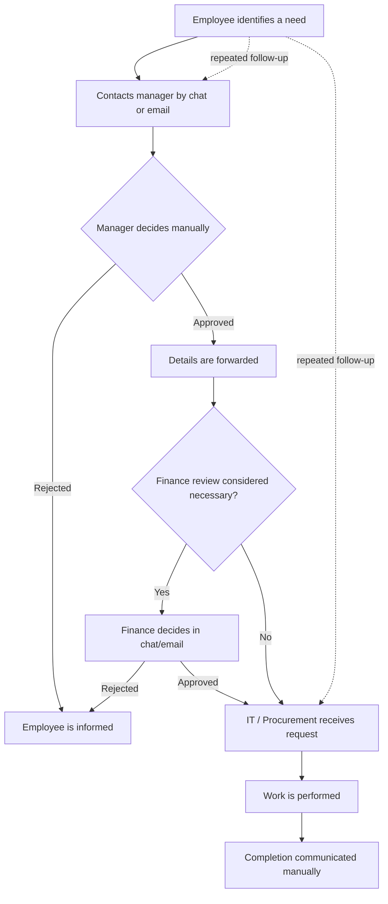

# AS-IS process (assumed manual scenario)

This diagram represents a hypothetical portfolio scenario rather than a documented
process at a real organization.

## Typical information movement

The initial need, estimated cost, approval, and delivery notes may be stored in
different messages or spreadsheet rows. A status label can depend on one person's
manual update. Finance routing may rely on memory, and ownership can be implicit.

## Pain points

- No single request record establishes the current state.
- Approvals and rejection reasons are difficult to reconstruct.
- Employees depend on manual follow-up for progress.
- Hand-offs can omit context or create duplicate records.
- Deadline risk is not calculated consistently.
- Management reporting requires manual reconciliation.

The [TO-BE process](to-be-process.md) shows how RequestFlow addresses these points.
