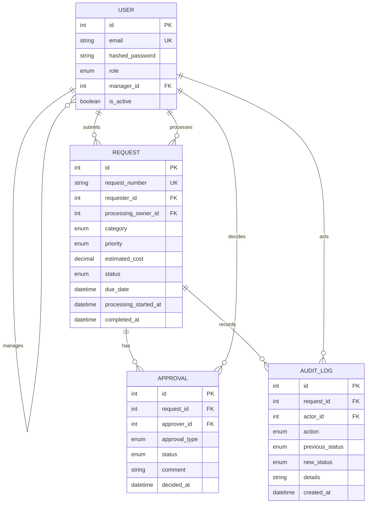

# Database design

PostgreSQL stores four main entities. SQLAlchemy declares the models and Alembic
revisions 0001–0003 create the schema.

## Relationships and constraints

- `users.manager_id` is a nullable self-reference. One manager can have many direct
  reports; a user cannot be their own manager.
- `requests.requester_id` identifies the owner. `processing_owner_id` is required
  only for Processing/Completed requests.
- `approvals` has one row per request and stage through a unique constraint. Manager
  stages have an assigned approver; Finance records the authorized user who decides.
- `audit_logs.actor_id` is nullable because an automatic system event can have no
  human actor. Each event retains its request and optional previous/new state.
- Cost uses `NUMERIC(15,2)`, not floating point. Checks require non-negative values
  and consistent processing/completion timestamps.

## Request numbers

The PostgreSQL `request_number_seq` allocates the numeric portion of display values
such as `REQ-2026-0042`. A sequence stays safe under concurrent inserts and may leave
gaps after rollback. A gap is expected sequence behavior, not evidence of deleted data.
The counter does not reset each calendar year.

## Audit protection

The API exposes no audit mutation endpoint. Revision 0003 adds database protections
against ordinary update, delete, and truncate operations. A database owner retains
the ability to change the database, so this is append-only application history rather
than cryptographically tamper-proof storage.
