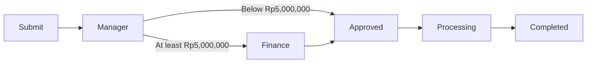

# Procurement / IT fulfillment — Phase 5

The existing PROCUREMENT role operates fulfillment. Employees, Managers, Finance,
and Admin cannot perform these actions. Admin remains read-only.

Rejection stops the approval path. Requester cancellation remains available only
before Manager review. No inventory, purchasing, reassignment, or escalation module
is included.

## Queue and ownership

`GET /procurement/queue` requires Procurement. It includes APPROVED and PROCESSING;
optional `status=APPROVED` or `status=PROCESSING` powers Ready to Process / In Progress.
Pagination uses offset and limit (default 20, maximum 100). Sorting is SLA urgency (Breached → Due Soon → On Track), then priority HIGH → MEDIUM → LOW, due date ascending, creation time ascending, and ID ascending.
Completed, rejected, cancelled, and pending approvals do not enter this queue.
The response retains the shared request summary: number, title, requester, category,
priority, decimal cost, status, creation/update timestamps, and due date.
Approval dates remain available in the detail's approval records.

Starting processing assigns the authenticated operator, with a server-generated
UTC start time. Only that operator can complete it. Other Procurement users can
view the request but receive no completion action and cannot bypass the API check.
There is no Admin override or owner-transfer endpoint. If an operator becomes
inactive, completion awaits a future explicitly designed reassignment process.

## API and state rules

| Endpoint | Allowed transition | Body |
| --- | --- | --- |
| POST /requests/{id}/start-processing | APPROVED → PROCESSING | `{}` or `{"note":"Work scheduled."}` |
| POST /requests/{id}/complete | PROCESSING → COMPLETED | `{}` or `{"note":"Equipment delivered."}` |

Notes are optional, trimmed, at most 2,000 characters, and stored on audit events.
Unknown input fields are rejected; clients cannot supply owner/status/timestamps.
Requests that Procurement cannot see return 404, including pending, rejected, and
cancelled requests. Wrong-role actions on visible requests return 403. Invalid or
repeated transitions return 409. Another operator's completion returns 403.

Request detail exposes a safe processing-owner profile, processing_started_at,
completed_at, and backend-derived allowed_actions. Procurement can still open
completed detail/history even though it is no longer in the active queue.
Other roles retain their existing request visibility.

## Consistency

The shared workflow service locks the request row with SELECT FOR UPDATE, checks
permissions and current state again, updates fields, and appends its audit event.
The route commits once. Concurrent starts/completions serialize; the loser sees
the new state and cannot create a duplicate event. Constraints require ownership
and a start time for processing/completed states, a completion time only for
completed state, and completion no earlier than start.

Revision 0003 adds the owner foreign key, index, timestamps, constraints, and audit
schema. Fresh upgrade, legacy upgrade, downgrade/re-upgrade, and Alembic drift are
tested in isolated schemas. Downgrade removes audit history and fulfillment fields;
it deliberately refuses while PROCESSING or COMPLETED requests exist. Use backups
and disposable schemas to test destructive migration paths, not the working demo.

SLA state is calculated at read time. See [SLA monitoring](sla-monitoring.md) for boundaries and refresh behavior.

