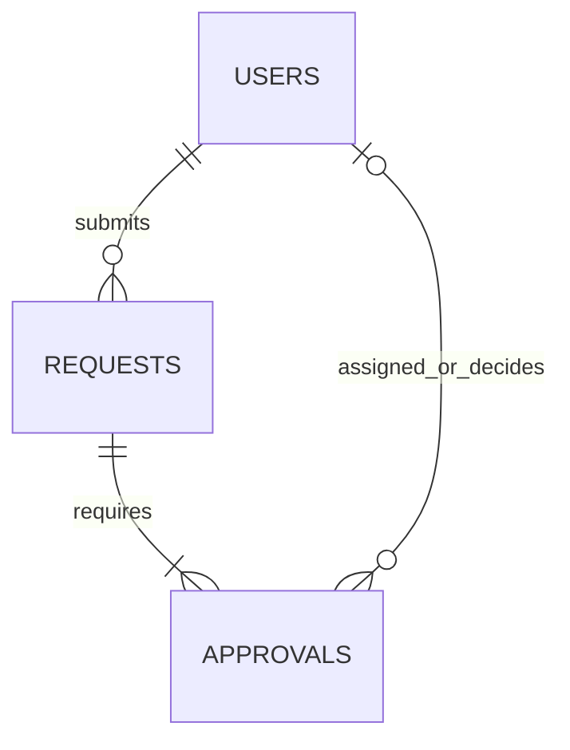

# Request management — Phases 3 and 4

Requests record a business need; approval rows record the decisions required to
authorize it. PostgreSQL owns both tables, with Alembic revision `0002` creating
their enums, foreign keys, indexes, constraints, and numbering sequence.

## Data model



`requests` stores category, title, description, business justification, priority,
estimated cost, current status, and timestamps. `requester_id` references `users`;
names and emails are read through the relationship rather than copied into requests.
Money is `NUMERIC(15,2)` / Python `Decimal`. API decimal strings preserve precision.
The UI formats Rupiah without converting the stored value to a binary float.

`approvals` stores one row per request and stage (Manager or Finance), its status,
assigned/deciding user, optional comment, creation time, and decision time. Rejection
requires a nonblank reason in both API validation and a database constraint.
The unique `(request_id, approval_type)` constraint prevents duplicate stages.

The pending Manager row names the assigned manager. Pending Finance has no individual
assignee: any active Finance user may decide; the winner's ID is stored. Cancelling
a request marks its pending Manager stage `CANCELLED`. In that case `decided_at`
means stage closure, and the retained manager assignment is not a claim that the
manager cancelled it. The audit timeline explicitly identifies the cancellation actor.

## Creation and numbering

Employees and managers can submit if they have a different, active `MANAGER`
assigned. Submission otherwise returns 409, with a setup explanation. The top-level
demo manager has no manager and therefore cannot submit until one is assigned.
Finance, Procurement, and Admin do not submit in these phases.

The backend obtains `nextval('request_number_seq')` and formats it as
`REQ-<UTC year>-<counter padded to at least four digits>`. PostgreSQL allocates each
counter atomically even across simultaneous connections. A unique index adds a
second safeguard. The counter never resets annually; rolled-back submissions may
leave gaps. Neither gapless numbering nor row-count numbering is promised.

Due dates use the same UTC creation timestamp plus **calendar days**: High 1,
Medium 3, Low 5. This is centralized in `services/rules.py`. Display dates use
Asia/Jakarta. There is no business-day calendar. SLA state is now calculated at read time; see [SLA monitoring](sla-monitoring.md).

## API

All endpoints require a valid active-user Bearer token.

| Method and path | Behavior |
| --- | --- |
| `POST /requests` | Submit and atomically create pending Manager approval (201) |
| `GET /requests?own=false&offset=0&limit=20` | Paginated visible requests; limit 1–100 |
| `GET /requests/{id}` | Detail, safe requester/approver profiles, approval steps, `finance_required`, `allowed_actions` |
| `PATCH /requests/{id}/cancel` | Owner cancels while pending Manager review |
| `POST /requests/{id}/manager-approval` | Assigned manager approves/rejects |
| `POST /requests/{id}/finance-approval` | Finance decides a routed request |
| `GET /approvals/pending?offset=0&limit=20` | Paginated pending requests for the approver; oldest first |

Create body:

```json
{
  "category": "HARDWARE",
  "title": "Service desk monitor",
  "description": "A second monitor for support tasks.",
  "business_justification": "View incident context while helping employees.",
  "estimated_cost": "2000000.00",
  "priority": "MEDIUM"
}
```

Title is 1–160 characters, description 1–10,000, justification 1–5,000 after trimming.
Cost must be nonnegative with at most two decimal places and thirteen integer digits.
Use a decimal string; binary-float JSON values are rejected. Server-owned fields
such as requester, status, dates, and request number are rejected if supplied.

Decision body: `{"decision":"APPROVE"}` or
`{"decision":"REJECT","comment":"Budget not justified."}`.
Comments are at most 2,000 characters. Approve comments are optional.

Responses use 401 for unauthenticated/inactive users, 403 for forbidden actions on
visible requests, 404 for absent **or invisible** requests, 409 for stale/invalid
workflow actions or missing-manager setup, and 422 for invalid inputs. There is
no general-purpose status-update, edit, delete, or resubmit endpoint.

## Visibility and frontend

| Role | List/detail visibility | Actions |
| --- | --- | --- |
| Employee | Own requests | Submit; cancel own eligible request |
| Manager | Own and current direct reports | Submit with assigned manager; decide assigned Manager stage; cancel own eligible request |
| Finance | Requests with a Finance approval record, including decided history | Decide pending Finance stage |
| Admin | All | Read only; no silent approval override |
| Procurement | Approved, Processing, Completed | Start work; complete only assigned work |

My Requests uses `own=true`; managers can include direct reports with a checkbox.
Finance's navigation links to its pending queue. Admin gets a read-only Requests
page. Detail actions come from the backend's `allowed_actions`; hiding buttons is
convenience, not access control. The server repeats every authorization check.

The form prevents double-click submissions while a request is in flight, but does
not promise network-level idempotency after an ambiguous timeout. Request detail
shows safe plain-text comments, approval outcomes, fulfillment fields, and an audit timeline. See [Procurement](procurement-workflow.md) and [audit](audit-trail.md).

See [workflow engine](workflow-engine.md) for transitions and transaction behavior.


