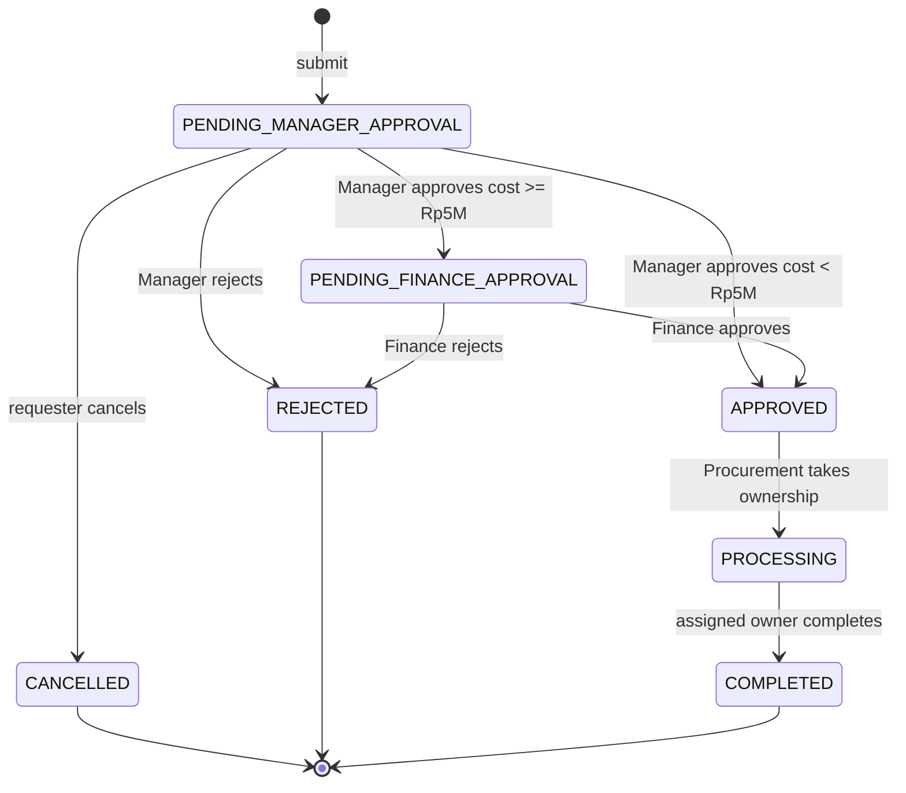

# Request state machine

`DRAFT` exists in the database enum for future-compatible modeling but the current
submission API creates Pending Manager Approval directly. It has no browser creation flow.

The workflow service is the transition authority. It verifies current state, actor
role, request visibility, assigned approver or fulfillment owner, and required input.
Invalid or stale visible transitions return a conflict; unauthorized roles return
forbidden; invisible objects return not found. Row locks ensure simultaneous actions
cannot both advance the same request.

Rejected, Cancelled, and Completed are terminal. Admin has global read access but no
transition override. See [business rules](business-rules.md) for the normative rules.
