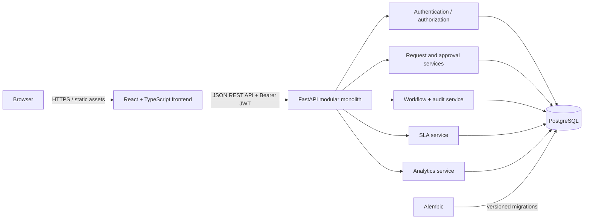

# System architecture

RequestFlow is a modular monolithic web application. One React client calls one
FastAPI application, and the API owns access to one PostgreSQL database. The backend
is separated into API, service, schema, model, configuration, and security modules;
it is not a microservices system.

## Responsibilities

- **React frontend:** routing, forms, role-appropriate navigation, status/SLA display,
  charts, confirmations, and session lifecycle. It never decides authorization.
- **FastAPI API layer:** validates transport input, authenticates requests, binds
  role dependencies, and maps service results to explicit response schemas.
- **Services:** implement visibility, request creation, workflow transitions, row
  locking, audit append, SLA rules, queue ordering, and SQL aggregation.
- **SQLAlchemy models and PostgreSQL:** relationships, numeric precision, enums,
  uniqueness, referential integrity, state-field constraints, and transactional storage.
- **Alembic:** creates and evolves production/local schema; application startup does
  not call `create_all`.

## Request path

1. The frontend sends a JWT in the Authorization header.
2. The API verifies its signature and claims, then reloads the active user and role.
3. The endpoint/service enforces role, object visibility, current state, and ownership.
4. A mutation locks the request, updates related rows, and appends audit events.
5. The transaction commits before a typed response is returned.

Deployment keeps the same architecture: Vercel serves the static SPA; Railway runs
the FastAPI container and a PostgreSQL service. See [deployment](deployment.md).
