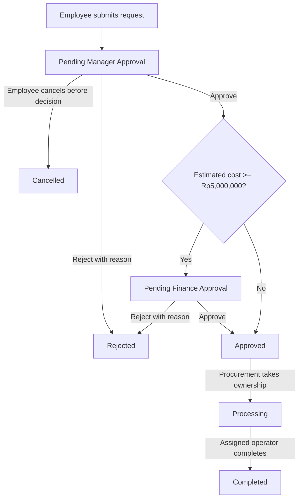

# TO-BE process with RequestFlow

RequestFlow provides one request record and a backend-enforced sequence of decisions
and fulfillment actions.

## What is automated

- The authenticated user becomes the requester; requester and status cannot be spoofed.
- The request is routed to the requester's active assigned manager.
- The exact cost threshold determines whether Finance is required.
- Each action is checked against role, object visibility, current state, and ownership.
- Workflow changes and their audit events commit in one transaction.
- Due dates and SLA labels follow centralized rules.
- Admin analytics aggregate the stored workflow data.

Notifications and automatic escalations are not implemented. Users open or refresh
the application to see changes. See [business rules](business-rules.md) and the
[request state machine](request-state-machine.md).
