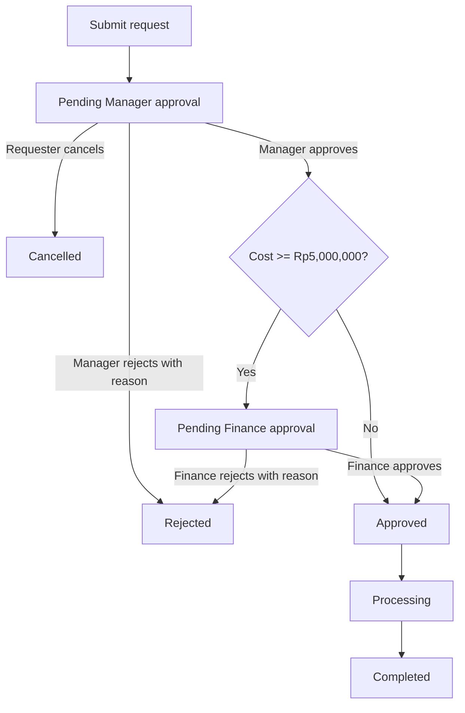

# Workflow engine — through Phase 6

The backend owns transitions. Routes validate/serialize HTTP input and commit the
transaction; `services/workflow.py` authorizes actions and updates related records.

`FINANCE_APPROVAL_THRESHOLD = Decimal("5000000.00")` lives once in
`services/rules.py`. Exactly Rp5,000,000 requires Finance. Below it, no Finance
approval row is created. Detail responses expose `finance_required`, so the browser
does not duplicate the cost comparison. Due-date calculation is in the same module.

## Deterministic transitions

`TRANSITIONS` maps `(current state, action)` to the next state. `next_status` rejects
anything not in that map with 409. Manager approval has the single cost-dependent
branch shown above. Role authorization happens before applying a valid transition.

| Current state | Action | Result |
| --- | --- | --- |
| Pending Manager | Owner cancels | Cancelled; Manager stage closed as cancelled |
| Pending Manager | Assigned manager approves | Approved, or Pending Finance at/above threshold |
| Pending Manager | Assigned manager rejects | Rejected with reason |
| Pending Finance | Finance approves | Approved |
| Pending Finance | Finance rejects | Rejected with reason |

Draft remains reserved. Approved → Processing → Completed now uses the same workflow service. Only Procurement can start work; only the assigned operator can complete it. Rejected and Cancelled cannot continue. There is no administrator override or self-approval.

## Assignment rules

Submission snapshots the manager assignment into the pending approval. A decision
requires both that assignment and the requester's current manager relationship,
as well as the MANAGER role. Changing the manager through external SQL can leave
the stage blocked; reassignment is deliberately not exposed yet. This prevents a
former manager from deciding after losing authority. Future user-management work
must define explicit pending-approval reassignment.

Finance is a shared role queue, not an arbitrary individual selected by row order.
The first authorized decision records its actor. Admin can inspect all requests
but does not substitute for either business role.

## Transactions and competing decisions

1. Load a visible request with PostgreSQL `SELECT ... FOR UPDATE`.
2. Recheck role/assignment, current status, and pending approval under that lock.
3. Update the approval, request status, and timestamps. When needed, insert the
   Finance stage in the same database session.
4. Append meaningful audit events in the same session; commit once. On failure the session rolls back all changes.

All decisions and cancellations lock the same request row. A concurrent second
decision waits, then sees the updated state and receives a conflict. The database
unique constraint on request/stage independently prevents duplicate approvals.

Tests exercise concurrent request creation, competing Manager and Finance decisions,
and an injected failure during Finance creation that leaves both request and Manager
approval unchanged. No background automation is required for these rules.

Approval records retain decision provenance. The append-only audit log now records every supported workflow action; see [audit design](audit-trail.md).

## Demo walkthrough

Use separate browser profiles or log out between roles. Every demo account starts
with password `RequestFlow-Demo!2026`.

1. Employee submits a Rp2,000,000 request; Manager opens Approvals, reviews it,
   and approves. Employee sees Approved and Finance: Not required.
2. Employee submits Rp10,000,000; Manager approves; Finance opens Finance Approvals
   and approves. The detail shows both named decisions and Approved status.
3. Manager rejects another request with a reason. Employee sees Rejected and the reason.
4. Employee cancels before Manager review. The queue excludes it and any stale
   approval attempt fails.

See [Procurement workflow](procurement-workflow.md) for ownership, queue ordering, and fulfillment transitions.

References: [PostgreSQL sequences](https://www.postgresql.org/docs/16/functions-sequence.html)
and [SQLAlchemy sessions](https://docs.sqlalchemy.org/en/20/orm/session_api.html).

